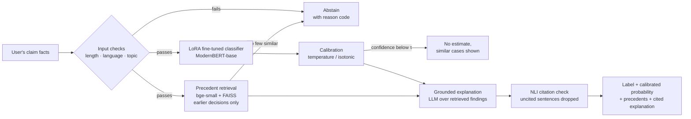

<!--
  README lifecycle
  - PR 1  (chore/scaffold): stub — title, one-line description, disclaimer, "work in progress" notice, setup commands.
  - PR 2–17: only the "Status" checklist and the docs index change.
  - PR 18 (release/v1.0): this full version. Everything between the RESULTS markers is written by
    `make report` from reports/metrics.json; never edit those numbers by hand
    (test_readme_numbers_match_report fails if they drift).
  Placeholders ⟨PR n⟩ must all be gone at the v1.0 tag (test_no_placeholders).
-->

# ClaimSense

**Predicts how an insurance ombudsman is likely to rule on a rejected health-insurance claim, with a calibrated probability, the most similar past decisions as precedents, and a plain-language explanation in which every sentence cites one of those precedents.**

[](https://github.com/Inquisitiveshri34/claimsense/actions/workflows/ci.yml)


> [!IMPORTANT]
> **ClaimSense describes how similar past cases were decided. It is not legal advice; the ombudsman decides each case on its own facts.**
> It learned only from disputes that reached an ombudsman and ended in a published decision, and it cannot see your documents. See [Limitations](docs/responsible-ai/limitations.md) and [Responsible use](docs/responsible-ai/responsible-use.md).

---

## Contents

1. [The problem](#1-the-problem)
2. [How it works](#2-how-it-works)
3. [Results](#3-results)
4. [Quick start](#4-quick-start)
5. [Reproduce the results](#5-reproduce-the-results)
6. [Repository layout](#6-repository-layout)
7. [Data and licences](#7-data-and-licences)
8. [Documentation](#8-documentation)
9. [Limitations in brief](#9-limitations-in-brief)
10. [Citation and acknowledgements](#10-citation-and-acknowledgements)

---

## 1. The problem

Policyholders rarely understand their health-insurance policies, so when a claim is rejected they cannot tell whether the rejection is fair or worth contesting.

- Indian health insurers disallowed **₹15,100 crore** of claims in FY24, **12.9%** of all claims filed (IRDAI Annual Report 2023-24).
- Health-insurance complaints rose **41%** to **1,37,361** in FY25, driven mainly by claim disputes, delays and partial settlements (IRDAI Annual Report 2024-25).
- The answers already exist in public: ombudsmen publish thousands of decisions on exactly these disputes. They are long, scattered PDFs that no ordinary policyholder will read.

ClaimSense turns those past decisions into a usable signal for a new dispute.

| User | Question ClaimSense helps with |
|---|---|
| Policyholder with a rejected claim | "Is it worth taking my case to the ombudsman?" |
| Family member or caregiver | "Why was this rejected, and how did similar cases go?" |
| Insurance advisor or consumer-help volunteer | "Which past decisions are closest to this person's case?" |

---

## 2. How it works

A fixed pipeline, **no agents and no MCP**:



Full diagram: [`docs/figures/system-architecture.png`](docs/figures/system-architecture.png) · Stage-by-stage: [`docs/architecture/data-flow.md`](docs/architecture/data-flow.md)

| Step | What happens | Spec |
|---|---|---|
| **1. Input** | The user describes what happened, what the policy says and why the insurer refused | [`pipeline-interface.md`](docs/architecture/pipeline-interface.md) |
| **2. Predict** | A LoRA-adapted `answerdotai/ModernBERT-base` classifies the facts as *Upheld / Partially upheld / Rejected* | [`finetuning-spec.md`](docs/modelling/finetuning-spec.md) |
| **3. Calibrate** | Raw scores become probabilities you can read at face value (target test ECE ≤ 0.05) | [`calibration.md`](docs/modelling/calibration.md) |
| **4. Retrieve** | The most similar past decisions, **dated earlier than the case**, are shown as precedents | [`retrieval-design.md`](docs/modelling/retrieval-design.md) |
| **5. Explain** | An LLM writes a short explanation from the precedents' findings only; an NLI checker drops any sentence its cited precedent does not support | [`prompt-spec.md`](docs/modelling/prompt-spec.md), [`citation-checking.md`](docs/modelling/citation-checking.md) |
| **6. Abstain** | Too short, not English, off-topic, no close precedents, or low confidence → it says so instead of guessing | [`abstention-policy.md`](docs/modelling/abstention-policy.md) |

**Core design rule:** the model sees only the *facts* of each case (complaint and insurer's position), never the ombudsman's findings or award, so it cannot learn by reading the answer. Leak-probe tests enforce this in CI ([`leakage-contract.md`](docs/architecture/leakage-contract.md)).

---

## 3. Results

Test split = decisions dated **2025 onward**, never seen during training, tuning, calibration or threshold selection. All intervals are 95% bootstrap CIs. Full report: [`reports/evaluation-report.md`](reports/evaluation-report.md).

<!-- RESULTS:START — generated by `make report`; do not edit by hand -->

**Dataset** `⟨dataset_version⟩` · **Model** `⟨model_id⟩` (seed ⟨seed⟩, median of 3) · **Test n** = ⟨n_test⟩ (India ⟨n_in⟩ · UK ⟨n_gb⟩ · Ireland ⟨n_ie⟩)

### Classification (full coverage, abstention off)

| Model | Macro-F1 [95% CI] | F1 partially upheld | PR-AUC (any payment) |
|---|---|---|---|
| B1 Majority class | ⟨PR 14⟩ | ⟨PR 14⟩ | ⟨PR 14⟩ |
| B2 Rejection-reason rules | ⟨PR 14⟩ | ⟨PR 14⟩ | ⟨PR 14⟩ |
| B3 TF-IDF + logistic regression | ⟨PR 14⟩ | ⟨PR 14⟩ | ⟨PR 14⟩ |
| B4 Sentence embeddings + LR | ⟨PR 14⟩ | ⟨PR 14⟩ | ⟨PR 14⟩ |
| B5 Zero-shot LLM | ⟨PR 14⟩ | ⟨PR 14⟩ | ⟨PR 14⟩ |
| **ClaimSense (LoRA fine-tuned)** | **⟨PR 14⟩** | **⟨PR 14⟩** | **⟨PR 14⟩** |
| ClaimSense, **India only** | ⟨PR 14⟩ | ⟨PR 14⟩ | ⟨PR 14⟩ |

### Release gates

| Gate | Target | Result | Status |
|---|---|---|---|
| E1 Beats every baseline | CI does not overlap B3 | ⟨PR 14⟩ | ⟨✅ / ❌⟩ |
| E4 Calibration | Test ECE ≤ 0.05 | ⟨PR 14⟩ | ⟨✅ / ❌⟩ |
| E5 Abstention | Selective macro-F1 ≥ full-coverage | ⟨PR 16⟩ at coverage ⟨PR 16⟩ | ⟨✅ / ❌⟩ |
| E6a Precedents from the past only | 100% earlier-dated | ⟨PR 14⟩ | ⟨✅ / ❌⟩ |
| E7a Every shown sentence cited | 100% | ⟨PR 14⟩ | ⟨✅ / ❌⟩ |
| E7b Cited sentences supported (40-case audit) | ≥ 0.90 | ⟨PR 15⟩ | ⟨✅ / ❌⟩ |
| E8 Latency on a laptop CPU | p95 ≤ 10 s | ⟨PR 16⟩ | ⟨✅ / ❌⟩ |

**Abstain rate on test:** ⟨PR 16⟩ (low confidence ⟨…⟩ · off-topic ⟨…⟩ · no precedents ⟨…⟩)

<!-- RESULTS:END -->

**How to read this table**

- **Macro-F1** averages F1 over the three outcomes equally, so a model cannot score well by ignoring the rare *partially upheld* class.
- **India only** is reported separately because UK and Irish rules differ from India's; a good pooled number can hide a weak Indian one.
- If a gate is ❌, the action taken is recorded in the evaluation report (§10), not hidden.

---

## 4. Quick start

**Requirements:** Python 3.11, [uv](https://docs.astral.sh/uv/), GNU Make, Tesseract ≥ 5 (only for building data). Linux, macOS or WSL2. No GPU needed to run the app.

```bash
git clone https://github.com/Inquisitiveshri34/claimsense.git
cd claimsense
uv sync --frozen --all-extras          # install exactly what uv.lock pins
uv run pre-commit install              # lint + the data/PDF guard hook
cp .env.example .env                   # add a Groq or Gemini key for explanations
make test                              # passes with no data and no API keys
```

### Run the app

```bash
make models-cache        # optional: pre-download base model, encoder and NLI model
make app                 # Streamlit on http://localhost:8501
```

The app has four pages: **Predict**, **Precedent Explorer**, **Model Card** and **Data Explorer**, each with the disclaimer. Walkthrough: [`docs/operations/user-guide.md`](docs/operations/user-guide.md).

### Use the pipeline from Python

```python
from claimsense import predict

result = predict(
    "My father was admitted for a knee replacement. The insurer rejected the claim, "
    "saying osteoarthritis was a pre-existing disease not disclosed on the proposal form. "
    "He was diagnosed eight months after the policy started..."
)

if result.abstained:
    print(result.abstain_code, result.message)
else:
    print(result.label, result.probabilities)       # e.g. "partially_upheld", {...}
    for p in result.precedents:
        print(p.doc_id, p.country, p.decision_year, p.outcome)
    print(result.explanation)                       # every sentence carries a [P#] citation
```

Interface contract: [`docs/architecture/pipeline-interface.md`](docs/architecture/pipeline-interface.md).

> **Note on data.** The processed dataset and precedent index are released only where the source's terms allow it (see [§7](#7-data-and-licences)). Without them, `make app` runs in demo mode on the anonymised fixture set.

---

## 5. Reproduce the results

```bash
make reproduce
```

On a fresh clone with the permitted data in place, this rebuilds the dataset, checks its content hash against the released `dataset_version`, re-runs calibration, retrieval and evaluation with the released adapter, and compares the test metrics with [`reports/metrics.json`](reports/metrics.json) within the stated tolerance. Fine-tuning itself runs on a free Kaggle T4 notebook ([`notebooks/kaggle_finetune.ipynb`](notebooks/kaggle_finetune.ipynb)).

Details, tolerances and what to do on a mismatch: [`docs/operations/reproduction.md`](docs/operations/reproduction.md).

---

## 6. Repository layout

```text
claimsense/
├── README.md               ← you are here
├── DATA_SOURCES.md         sources at a glance → docs/data/data-sources.md
├── DATA_CARD.md            the released dataset version: sources, dates, counts, gaps
├── MODEL_CARD.md           intended use, metrics, calibration, failure modes, abstain rate
├── LICENSE                 MIT, code only (data has its own terms)
├── CHANGELOG.md            one entry per PR
├── CITATION.cff            how to cite ClaimSense and its data sources
├── config.yaml             every tunable setting (docs/operations/configuration.md)
├── pyproject.toml · uv.lock · requirements-lock.txt · Makefile
├── src/claimsense/
│   ├── collect/            CIOINS, FOS, FSPO collectors (polite, resumable)
│   ├── parse/              PDF → text, OCR fallback, per-source segmenters
│   ├── dataset/            labels, anonymiser, dedup, temporal split, data card
│   ├── models/             baselines, LoRA fine-tune, calibration
│   ├── retrieve/           encoder, FAISS index, date filter
│   ├── explain/            prompt, LLM client, NLI citation checker
│   ├── pipeline/           predict(), abstention
│   ├── eval/               evaluation report, slices, audits
│   └── app/                Streamlit pages
├── tests/                  unit, collector, leak probes, pipeline, app (fixtures only)
├── notebooks/              eda.ipynb, kaggle_finetune.ipynb
├── reports/                evaluation report, error analysis, figures (generated)
├── docs/                   design, data, modelling, evaluation, responsible-AI and ops docs
├── data/                   git-ignored; raw PDFs never leave the laptop
├── models/                 LoRA adapter, calibrator, thresholds (base weights never stored)
└── index/                  precedent index (released only where terms allow)
```

---

## 7. Data and licences

| Source | Country | Role | Terms (audited 2026-11-12) | Used in v1.0 |
|---|---|---|---|---|
| Council for Insurance Ombudsmen (CIOINS) | India | Primary target domain | Authorisation required | ⟨yes / no — PR 7⟩ |
| Financial Ombudsman Service (FOS) | UK | Training volume | Prior permission required for storage | ⟨yes / no — PR 7⟩ |
| Financial Services and Pensions Ombudsman (FSPO) | Ireland | Clean labels | Re-use permitted under PSI rules, with attribution | ✅ |

- **Code** is MIT-licensed ([`LICENSE`](LICENSE)). The licence does **not** cover any ombudsman text, the processed dataset or the precedent index.
- **Raw PDFs and decision pages are never published.** All personal data is removed before any processed text is written ([`anonymisation-spec.md`](docs/data/anonymisation-spec.md)).
- **What is published** per source follows the usage decision in [`terms-of-use-audit.md`](docs/data/terms-of-use-audit.md) §6: code, aggregate statistics and model weights always; processed text only where the source permits it.
- **Base models** are downloaded from Hugging Face under their own licences: ModernBERT-base (Apache-2.0), bge-small-en-v1.5 (MIT), nli-deberta-v3-base (Apache-2.0). Confirm on each model card.

Attribution:

> Contains information from decisions of the Financial Services and Pensions Ombudsman (Ireland), © FSPO, re-used under the Re-use of Public Sector Information Regulations. Text has been anonymised and shortened by ClaimSense and is not reproduced in its original form.
>
> ⟨FOS and CIOINS attribution lines from `terms-of-use-audit.md` §5, only if permission was granted⟩

Summary: [`DATA_SOURCES.md`](DATA_SOURCES.md) · Released dataset: [`DATA_CARD.md`](DATA_CARD.md)

---

## 8. Documentation

| Area | Documents |
|---|---|
| **Product** | [PRD](docs/PRD.md) · [Scope](docs/scope.md) · [Functional requirements](docs/functional-requirements.md) · [Non-functional requirements](docs/non-functional-requirements.md) · [User stories](docs/user-stories.md) · [Acceptance criteria](docs/acceptance-criteria.md) |
| **Architecture** | [Data flow](docs/architecture/data-flow.md) · [Data schema](docs/architecture/data-schema.md) · [Leakage contract](docs/architecture/leakage-contract.md) · [Pipeline interface](docs/architecture/pipeline-interface.md) |
| **Data** | [Data sources](docs/data/data-sources.md) · [Terms-of-use audit](docs/data/terms-of-use-audit.md) · [Collection runbook](docs/data/collection-runbook.md) · [Segmentation rules](docs/data/segmentation-rules.md) · [Labelling guide](docs/data/labelling-guide.md) · [Anonymisation spec](docs/data/anonymisation-spec.md) · [Manual audit protocol](docs/data/manual-audit-protocol.md) · [Dataset versioning](docs/data/dataset-versioning.md) |
| **Modelling** | [Baselines](docs/modelling/baselines.md) · [Fine-tuning spec](docs/modelling/finetuning-spec.md) · [Experiment log](docs/modelling/experiment-log.md) · [Calibration](docs/modelling/calibration.md) · [Retrieval design](docs/modelling/retrieval-design.md) · [Prompt spec](docs/modelling/prompt-spec.md) · [Citation checking](docs/modelling/citation-checking.md) · [Abstention policy](docs/modelling/abstention-policy.md) |
| **Evaluation** | [Evaluation protocol](docs/evaluation/evaluation-protocol.md) · [Retrieval rubric](docs/evaluation/retrieval-rubric.md) · [Faithfulness rubric](docs/evaluation/faithfulness-rubric.md) · [Error taxonomy](docs/evaluation/error-taxonomy.md) · [Fairness analysis plan](docs/evaluation/fairness-analysis-plan.md) |
| **Reports** | [EDA findings](reports/eda-findings.md) · [Baseline results](reports/baseline-results.md) · [Evaluation report](reports/evaluation-report.md) · [Error analysis](reports/error-analysis.md) |
| **Responsible AI** | [Limitations](docs/responsible-ai/limitations.md) · [Responsible use](docs/responsible-ai/responsible-use.md) · [Privacy impact assessment](docs/responsible-ai/privacy-impact-assessment.md) |
| **Operations** | [Setup](docs/operations/setup.md) · [Configuration](docs/operations/configuration.md) · [CI/CD](docs/operations/ci-cd.md) · [Reproduction](docs/operations/reproduction.md) · [User guide](docs/operations/user-guide.md) |
| **Testing** | [Test strategy](docs/testing/test-strategy.md) · [Leak-probe tests](docs/testing/leak-probe-tests.md) · [Test fixtures](docs/testing/test-fixtures.md) |
| **Planning** | [PR plan](docs/planning/pr-plan.md) · [Roadmap](docs/planning/roadmap.md) · [Risk register](docs/planning/risk-register.md) · [v2 backlog](docs/planning/backlog-v2.md) |

---

## 9. Limitations in brief

> ClaimSense learned from health-insurance disputes that reached ombudsmen in India, the UK and Ireland and ended in a published decision; it knows nothing about claims that were settled or never escalated. UK and Irish rules differ from India's, and results for Indian cases are reported separately: ⟨India macro-F1⟩ vs ⟨overall macro-F1⟩. Outcomes in Indian awards were labelled by rules and are about ⟨label accuracy⟩ correct. The model was trained on decisions up to 2023 and tested on 2025 onward; rules may have changed since. It was trained on case summaries written by the ombudsman, not by users, so real-world accuracy is likely lower than reported. It cannot see your documents, and it declines to answer about ⟨100 − coverage⟩% of the time.

All fifteen limitations, with how each is measured: [`docs/responsible-ai/limitations.md`](docs/responsible-ai/limitations.md).

---

## 10. Citation and acknowledgements

If you use ClaimSense, please cite it with the metadata in [`CITATION.cff`](CITATION.cff) (GitHub's **"Cite this repository"** button reads it), and credit the ombudsman services whose published decisions made it possible.

Built by **Diya Shrivastava** (B.Tech CSE, Lovely Professional University) as a solo GenAI project in 18 pull requests. Changes are listed in [`CHANGELOG.md`](CHANGELOG.md).

---

<sub>ClaimSense describes how similar past cases were decided. It is not legal advice; the ombudsman decides each case on its own facts. It is not affiliated with or endorsed by CIOINS, FOS or FSPO.</sub>
