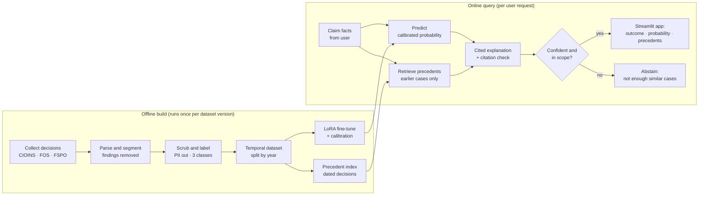

# ClaimSense — Architecture

> Two pipelines: an **offline build** that turns ombudsman decisions into a leakage-safe dataset, a fine-tuned model and a precedent index, and an **online query path** that turns a user's claim facts into a calibrated prediction with cited precedents.

**Author:** Diya Shrivastava

---

## 1. System at a glance



**Core rule:** findings are cut at the parsing stage, so only facts ever reach the model.

---

## 2. The leakage contract

Every decision document is split into four sections. Only the first two are allowed into the model input.

| Section | Example | Role |
|---|---|---|
| Complaint / background | "Hospitalised for 3 days; ₹1.2L claim repudiated for non-disclosure" | **Input** |
| Insurer's position | "The insurer says the condition existed before inception" | **Input** |
| Findings / reasoning | "I am satisfied the condition was not diagnosed before…" | Explanation reference only, never input |
| Award / decision | "I uphold this complaint and direct the insurer to pay…" | **Label** only |

**Other leakage paths, all blocked:**

| Leak | Guard | Where |
|---|---|---|
| Ombudsman reasoning in the input | Section segmenter + leak-probe tests | PR 5, PR 6 |
| Outcome words in the facts ("wrongly rejected") | Lexicon test, measured and reported | PR 6 |
| Future data in training | Temporal split by decision date | PR 7 |
| Same case in train and test | MinHash near-duplicate removal before splitting | PR 7 |
| Precedents from the future | Retrieval filtered to decisions dated before the query | PR 13 |

---

## 3. Components

### 3.1 Data layer (offline)

| Component | Responsibility | Tools |
|---|---|---|
| **Collectors** | Polite, resumable download of decision PDFs/pages; manifest with URL, date, source, hash | requests, BeautifulSoup, SQLite |
| **Parser** | PDF → text, OCR fallback for scanned awards | pdfplumber, Tesseract |
| **Segmenter** | Split each document into facts / insurer position / findings / award | Regex + per-source rules |
| **Labeller** | Map source wording to *Upheld / Partially upheld / Rejected* | Rule-based outcome extractor |
| **Anonymiser** | Remove names, addresses, phone, policy and claim numbers | Microsoft Presidio + custom Indian patterns |
| **Dataset builder** | Deduplicate, split by year, version, write data card | pandas, datasketch, DVC or version hash |

### 3.2 Model layer (offline)

| Component | Responsibility | Tools |
|---|---|---|
| **Baselines** | Majority class, rules, TF-IDF + LR, embeddings + LR, zero-shot LLM | scikit-learn, sentence-transformers |
| **Fine-tuned classifier** | LoRA on a small open model or encoder | transformers, PEFT, Kaggle/Colab GPU |
| **Calibrator** | Temperature scaling / isotonic on the validation set | scikit-learn |
| **Experiment tracking** | Every run's config, metrics and artifacts | MLflow or Weights & Biases |
| **Precedent index** | Embeddings of past decisions with date metadata | sentence-transformers + ChromaDB or FAISS |

### 3.3 Inference layer (online)

| Component | Responsibility | Tools |
|---|---|---|
| **`predict(facts)`** | Returns label, calibrated probability, precedents, explanation, abstain flag | Python package API |
| **Retriever** | Top-k similar decisions, dated before the query | Vector store with date filter |
| **Explainer** | LLM explanation grounded only in retrieved findings | Groq or Gemini API |
| **Citation checker** | Drops any sentence not supported by a cited precedent | NLI cross-encoder |
| **Abstention gate** | Refuses when confidence is low or input is off-topic | Threshold on calibrated probability + topic check |

### 3.4 App layer

| Page | Shows |
|---|---|
| **Predict** | Outcome, probability, top precedents, cited explanation, disclaimer |
| **Precedent Explorer** | Search and filter past decisions by reason, insurer type, year |
| **Model Card** | Metrics, calibration plot, known failure modes |
| **Data Explorer** | Dataset size, class balance, sources, data card |

---

## 4. Data flow and storage

```text
data/
├── raw/            # downloaded PDFs/HTML — git-ignored, never published
├── interim/        # extracted + segmented text — git-ignored
├── processed/      # anonymised, labelled dataset (Parquet) — versioned
└── manifests/      # per-source download manifests (SQLite/CSV)

models/
├── baselines/
├── lora-adapter/   # LoRA weights only, not the base model
└── calibrator.pkl

index/
└── precedents/     # vector store with decision dates
```

---

## 5. Repository layout

```text
claimsense/
├── src/claimsense/
│   ├── collect/        # cioins.py, fos.py, fspo.py
│   ├── parse/          # pdf_text.py, segment.py
│   ├── label/          # outcomes.py, anonymise.py
│   ├── dataset/        # dedup.py, split.py, datacard.py
│   ├── models/         # baselines.py, finetune.py, calibrate.py
│   ├── retrieve/       # index.py, search.py
│   ├── explain/        # generate.py, cite_check.py
│   ├── pipeline.py     # predict(facts)
│   └── config.py
├── app/                # Streamlit pages
├── notebooks/          # EDA, error analysis
├── tests/              # unit, leak-probe, pipeline tests
├── reports/            # evaluation report, figures
├── docs/               # 01-project-overview.md, 02-architecture.md, ...
├── DATA_SOURCES.md
├── MODEL_CARD.md
└── pyproject.toml
```

---

## 6. Design decisions

| Decision | Choice | Why |
|---|---|---|
| Architecture style | Fixed pipeline, no agents | Deterministic, testable, every step measurable |
| Input boundary | Facts + insurer position only | Prevents label leakage; mirrors what a user actually knows |
| Split | Temporal, not random | Tests the real use case: predicting new disputes |
| Model | LoRA on a small model | Fits a free GPU; adapter-only weights are small to ship |
| Output | Calibrated probability, not just a label | A person acts on the number, so it must mean what it says |
| Explanations | Retrieved precedents only, citation-checked | Stops the LLM inventing reasons |
| Failure mode | Abstain over guess | Wrong confidence on a medical-money dispute is worse than no answer |
| Privacy | Anonymise before processing; publish derived data only | Decisions name real complainants |

---

## 7. Quality gates

- **CI on every PR:** lint (ruff), format (black), unit tests, leak-probe tests.
- **Data gates:** segmenter ≥ 95% on 50 hand-checked documents; 0 PII hits on a 100-document sample.
- **Model gates:** fine-tuned model must beat every baseline on validation; test ECE ≤ 0.05.
- **Release gate:** a fresh clone reproduces the reported test metrics with one command.
