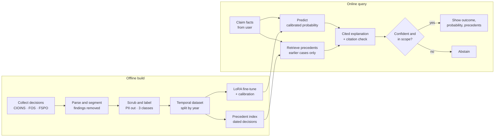

# ClaimSense — Project Description

> The detailed companion to `01-project-overview.md`. It specifies how ClaimSense works, what it must do, how it will be measured, how it is built across 18 PRs, and what could go wrong.

**Author:** Diya Shrivastava · **Type:** Solo GenAI project · **Status:** Planned

---

## Contents

1. Summary
2. Pipeline
3. Key design decisions
4. Functional requirements
5. Non-functional requirements
6. Data and manifest specification
7. Evaluation plan
8. Phased timeline (18 PRs)
9. Deliverables
10. Risks and mitigations

---

## 1. Summary

ClaimSense predicts how an insurance ombudsman is likely to rule on a rejected health-insurance claim. A user describes their dispute; the system returns:

- a **likely outcome**: *Upheld*, *Partially upheld* or *Rejected*;
- a **calibrated probability** for that outcome;
- the **most similar past decisions** as precedents;
- a **plain-language explanation** in which every sentence cites a precedent.

It learns from real, public ombudsman decisions from India (CIOINS), the UK (FOS) and Ireland (FSPO). It is a **fixed GenAI pipeline**, with no agents and no MCP, and it **abstains** when it cannot answer responsibly. It does not give legal advice.

---

## 2. Pipeline



| Stage | Input | Output |
|---|---|---|
| Collect | Source websites | Raw PDFs/HTML + manifest |
| Parse and segment | Raw documents | Text split into facts / insurer position / findings / award |
| Scrub and label | Segmented text | Anonymised facts + 3-class label |
| Temporal dataset | Labelled records | Deduplicated train / validation / test by year |
| Fine-tune + calibrate | Training split | LoRA adapter + calibrator |
| Precedent index | All dated records | Vector index with date metadata |
| Predict | User's facts | Label + calibrated probability |
| Retrieve | User's facts | Top-k earlier decisions |
| Explain | Prediction + precedents | Cited explanation, uncited sentences removed |
| Gate | All of the above | Answer or abstain |

---

## 3. Key design decisions

| # | Decision | Choice | Rationale | Alternative rejected |
|---|---|---|---|---|
| D1 | Input boundary | Facts + insurer's position only | Findings contain the answer; including them makes accuracy meaningless | Full decision text |
| D2 | Data split | Temporal (train ≤ 2023, val 2024, test 2025+) | Mirrors real use: predicting *new* disputes | Random split (overstates accuracy) |
| D3 | Labels | 3 classes + a binary "any payment" view | Partial payment is common and matters to users | Binary only |
| D4 | Model | LoRA on a small open model or encoder | Fits a free GPU; adapter weights are small | Full fine-tune; API-only zero-shot |
| D5 | Output | Calibrated probability | Users act on the number, so 70% must mean 70% | Raw softmax scores |
| D6 | Explanations | Grounded in retrieved findings, citation-checked | Prevents invented reasons | Free LLM explanation |
| D7 | Precedent retrieval | Only decisions dated before the query | Blocks leakage from the future | Unfiltered retrieval |
| D8 | Failure behaviour | Abstain when unsure or off-topic | Wrong confidence is worse than no answer | Always predict |
| D9 | Architecture | Fixed pipeline, no agents | Deterministic and measurable at every step | Agentic workflow |
| D10 | Privacy | Anonymise before writing processed text; publish derived data only | Decisions name real complainants | Publish raw text |
| D11 | Jurisdictions | India + UK + Ireland, India as primary test domain | Indian volume alone may be too small; shift becomes a finding | India only |

---

## 4. Functional requirements

### Data

| ID | Requirement | PR |
|---|---|---|
| FR-01 | The system shall download health-related ombudsman decisions from CIOINS, FOS and FSPO into a local raw store. | 3, 4 |
| FR-02 | The system shall record every downloaded document in a manifest with source, URL, date, insurer, product, raw outcome and file hash. | 3, 4 |
| FR-03 | Collectors shall resume from the manifest and skip already-downloaded files. | 3, 4 |
| FR-04 | The system shall extract text from PDFs, using OCR when no text layer exists. | 5 |
| FR-05 | The system shall split each decision into facts, insurer position, findings and award sections. | 5 |
| FR-06 | The system shall map each decision's outcome to *Upheld*, *Partially upheld* or *Rejected*, and exclude non-entertainable or withdrawn cases. | 6 |
| FR-07 | The system shall remove personal identifiers before writing processed text. | 6 |
| FR-08 | The system shall remove near-duplicate decisions before splitting. | 7 |
| FR-09 | The system shall produce a versioned dataset with a temporal split and a data card. | 7 |

### Modelling

| ID | Requirement | PR |
|---|---|---|
| FR-10 | The system shall train and log at least five baselines: majority class, rules, TF-IDF + LR, embeddings + LR, zero-shot LLM. | 9, 10 |
| FR-11 | The system shall fine-tune a classifier with LoRA and track every run's configuration and metrics. | 11 |
| FR-12 | The system shall calibrate predicted probabilities on the validation split. | 12 |
| FR-13 | The system shall index past decisions with their dates for similarity search. | 13 |

### Inference and app

| ID | Requirement | PR |
|---|---|---|
| FR-14 | `predict(facts)` shall return label, calibrated probability, top-k precedents, explanation and an abstain flag. | 16 |
| FR-15 | Retrieval shall return only decisions dated before the query case (or before today for live queries). | 13 |
| FR-16 | Every explanation sentence shall cite a retrieved precedent; unsupported sentences shall be removed. | 13 |
| FR-17 | The system shall abstain when calibrated confidence is below a set threshold or the input is not a health-insurance claim dispute. | 16 |
| FR-18 | The app shall provide Predict, Precedent Explorer, Model Card and Data Explorer pages. | 17 |
| FR-19 | Every app page shall show the not-legal-advice disclaimer. | 17 |
| FR-20 | One command shall regenerate the full evaluation report. | 14 |

---

## 5. Non-functional requirements

| ID | Category | Requirement | Measure |
|---|---|---|---|
| NFR-01 | Leakage safety | No findings or award text in model input | Leak-probe tests pass in CI |
| NFR-02 | Privacy | No personal identifiers in processed data | 0 hits on a 100-document manual sample + automated pattern scan |
| NFR-03 | Calibration | Probabilities match observed frequencies | Test ECE ≤ 0.05 |
| NFR-04 | Faithfulness | Explanations supported by cited precedents | 100% after filter; manual audit agrees ≥ 90% |
| NFR-05 | Reproducibility | Results can be regenerated from a fresh clone | Pinned dependencies, fixed seeds, dataset hash, one-command pipeline |
| NFR-06 | Latency | Interactive response | ≤ 10 s per prediction on a laptop CPU (excluding first model load) |
| NFR-07 | Cost | Runs on free resources | Training on free Kaggle/Colab GPU; inference without paid GPU |
| NFR-08 | Responsible scraping | Sources are not overloaded | ≤ 1 request per 2–3 s, single-threaded, identified User-Agent |
| NFR-09 | Licensing | Only permitted data is published | PR 2 checklist complete per source |
| NFR-10 | Code quality | Maintainable and tested | ruff + black clean; unit and pipeline tests pass in CI |
| NFR-11 | Transparency | Users can see limits | Model card lists metrics, failure modes and abstain rate |
| NFR-12 | Usability | Understandable by a non-expert | Outcome, probability and explanation readable without jargon |

---

## 6. Data and manifest specification

### 6.1 Sources

| Source | Country | Content | Outcome label |
|---|---|---|---|
| Council for Insurance Ombudsmen (CIOINS) | India | Monthly award PDFs, health-awards archive | Free text in the award order |
| Financial Ombudsman Service (FOS) | UK | Final decisions since April 2013 | Upheld / Not upheld |
| Financial Services and Pensions Ombudsman (FSPO) | Ireland | Legally binding decisions with metadata | Rejected / Partially upheld / Upheld / Substantially upheld |

Full details, terms-of-use checklist and anonymisation rules: `04-data-sources.md`.

### 6.2 Manifest (one row per downloaded document)

| Field | Type | Example | Required |
|---|---|---|---|
| `doc_id` | string | `cioins-2023-05-1004-0056` | Yes |
| `source` | enum | `cioins` / `fos` / `fspo` | Yes |
| `url` | string | original document URL | Yes |
| `decision_date` | date | `2023-05-12` | Yes |
| `insurer` | string | insurer name | Yes |
| `product` | enum | `individual_mediclaim`, `group_mediclaim`, `overseas_mediclaim`, `private_health` | Yes |
| `outcome_raw` | string | source wording | Yes |
| `office` | string | ombudsman office (India) | No |
| `file_sha256` | string | content hash | Yes |
| `fetched_at` | datetime | download timestamp | Yes |

### 6.3 Processed record (one row per usable decision)

| Field | Type | Description |
|---|---|---|
| `doc_id` | string | Joins to manifest (locally only) |
| `source` | enum | `cioins` / `fos` / `fspo` |
| `decision_date` | date | Drives the split |
| `split` | enum | `train` / `val` / `test` |
| `insurer_type` | enum | `public` / `private` / `standalone_health` |
| `rejection_reason` | enum | `non_disclosure`, `waiting_period`, `exclusion`, `not_medically_necessary`, `documentation`, `other` |
| `claim_amount_band` | enum | Amount band, where stated |
| `facts_text` | string | Anonymised facts + insurer position (**model input**) |
| `findings_text` | string | Anonymised findings (**explanation reference only**) |
| `label` | enum | `upheld` / `partially_upheld` / `rejected` |
| `label_binary` | bool | Any payment ordered |
| `dataset_version` | string | Content hash of the build |

### 6.4 Storage

```text
data/raw/         git-ignored, never published
data/interim/     git-ignored
data/processed/   Parquet, versioned
data/manifests/   SQLite/CSV
```

---

## 7. Evaluation plan

### 7.1 Metrics and targets

Targets are set before seeing the data. The report states them as goals and records what was actually reached.

| Area | Metric | Target |
|---|---|---|
| Classification | Macro-F1 (3 classes), temporal test set | Beats TF-IDF baseline; bootstrap CIs do not overlap |
| Binary view | PR-AUC for "any payment", with lift over base rate | Reported |
| Calibration | ECE, Brier score, reliability diagram | ECE ≤ 0.05 |
| Leakage check | Facts-only vs findings-included accuracy gap | Reported; a small gap signals leakage |
| Generalisation | Train UK + IE → test India (and reverse if data allows) | Reported as a domain-shift finding |
| Retrieval | Precedent topic match and outcome agreement on 40 hand-checked cases | Rubric in repo |
| Explanations | Share of sentences supported by a cited precedent | 100% after filter; manual audit ≥ 90% |
| Abstention | Coverage vs accuracy curve | Operating point justified |
| Latency | Seconds per prediction | ≤ 10 s on CPU |

### 7.2 Baselines

| Baseline | What it tests |
|---|---|
| Majority class | Floor performance |
| Rejection-reason rules | Whether the reason alone predicts the outcome |
| TF-IDF + logistic regression | Classic text baseline |
| Embeddings + logistic regression | Value of semantic features |
| Zero-shot LLM | Value of fine-tuning over prompting |

### 7.3 Breakdowns

Results are reported by source country, rejection reason, insurer type, claim-amount band and decision year.

### 7.4 Error analysis

50 misclassified test cases are categorised by cause (missing facts, unusual clause, label noise, jurisdiction mismatch, other), with counts.

---

## 8. Phased timeline (18 PRs)

Week estimates assume about 10–12 hours per week alongside coursework and are guides, not commitments.

| Phase | PRs | Est. weeks | Exit criterion |
|---|---|---|---|
| **1. Data** | 1–7 | 4 | Frozen, anonymised, leakage-safe dataset v1 |
| **2. Baselines** | 8–9 | 1 | Baseline numbers logged |
| **3. GenAI core** | 10–13 | 3 | Calibrated fine-tuned model + cited explanations |
| **4. Evaluation** | 14–15 | 1.5 | Evaluation report + failure analysis |
| **5. Product** | 16–18 | 1.5 | App running, v1.0 tagged |
| **Total** | **18** | **≈ 11** | |

| PR | Phase | Title | Done when |
|---|---|---|---|
| 1 | Data | Repo scaffold | CI green on a placeholder test |
| 2 | Data | Source audit | Every source has a licence decision |
| 3 | Data | India collector | Re-run downloads nothing new; manifest complete |
| 4 | Data | UK + Ireland collectors | All manifests share one schema |
| 5 | Data | Parse and segment | ≥ 95% correct on 50 hand-checked documents |
| 6 | Data | Labels, anonymisation, leak probes | Leak tests pass; 0 PII hits on 100-doc sample |
| 7 | Data | Dataset build | Dataset v1 frozen with version hash |
| 8 | Baselines | EDA notebook | Notebook renders; findings written |
| 9 | Baselines | Classic baselines | Macro-F1 and PR-AUC logged for each |
| 10 | GenAI core | Embedding classifier + zero-shot LLM | Beats TF-IDF, or gap explained |
| 11 | GenAI core | LoRA fine-tune | Beats every baseline on validation |
| 12 | GenAI core | Calibration | Test ECE ≤ 0.05 |
| 13 | GenAI core | Precedent retrieval + cited explanations | Every sentence cites a precedent |
| 14 | Evaluation | Evaluation report | One-command report |
| 15 | Evaluation | Error analysis and fairness | Failure modes written up with counts |
| 16 | Product | Inference pipeline | Tests pass; abstain rate reported |
| 17 | Product | Streamlit app | Runs locally from one command |
| 18 | Product | Docs and release | Fresh clone reproduces test metrics |

Branch names and full deliverables per PR: `03-pr-plan.md`.

**Checkpoint after PR 3:** if fewer than ~800 usable Indian health awards survive parsing, train on UK + Ireland and use India as an out-of-distribution test set.

---

## 9. Deliverables

| # | Deliverable | Location |
|---|---|---|
| 1 | Source code (`claimsense` Python package) | `src/claimsense/` |
| 2 | Collectors and manifests | `src/claimsense/collect/`, `data/manifests/` |
| 3 | Processed, anonymised dataset (only if source terms permit) | `data/processed/` |
| 4 | Data card | `DATA_CARD.md` |
| 5 | Baseline and fine-tuned models (LoRA adapter + calibrator) | `models/` |
| 6 | Precedent index | `index/precedents/` |
| 7 | Evaluation report with figures | `reports/` |
| 8 | Error-analysis and fairness write-up | `reports/` |
| 9 | Model card | `MODEL_CARD.md` |
| 10 | Streamlit app | `app/` |
| 11 | Test suite and CI workflow | `tests/`, `.github/workflows/` |
| 12 | Project docs (01–05) | `docs/` |
| 13 | README with results table and reproduction steps | `README.md` |
| 14 | Tagged release v1.0 | GitHub releases |

---

## 10. Risks and mitigations

| # | Risk | Likelihood | Impact | Mitigation | Trigger / owner check |
|---|---|---|---|---|---|
| R1 | Too few usable Indian health awards | Medium | High | Train on UK + Ireland; India becomes the out-of-distribution test | < 800 usable awards after PR 5 |
| R2 | Terms of use forbid bulk collection or redistribution | Medium | High | Request permission; keep data local; publish code, statistics and weights only | PR 2 checklist |
| R3 | Findings leak into the input | Medium | High | Section segmenter, leak-probe tests, facts-vs-findings gap check | Leak tests in CI; suspiciously high accuracy |
| R4 | Segmenter fails on varied office layouts | High | Medium | Per-source and per-office rules; hand-check sample; drop unparseable files with a logged count | < 95% on 50-doc check |
| R5 | PII survives anonymisation | Medium | High | Presidio + Indian patterns + manual sample + automated scan; never publish raw text | Any hit in the 100-doc sample |
| R6 | Label noise from free-text Indian awards | Medium | Medium | Rule-based mapping, hand audit of 100 labels, report label accuracy | Audit accuracy < 95% |
| R7 | Class imbalance (e.g. few partial upholds) | High | Medium | Macro-F1, class weights, binary view reported alongside | Any class < 10% of data |
| R8 | Fine-tuning does not beat simple baselines | Medium | Medium | Report it honestly; analyse why; keep the strongest model | PR 11 validation results |
| R9 | Free GPU limits or session timeouts | Medium | Low | Small model, LoRA, gradient accumulation, frequent checkpoints | Repeated interrupted runs |
| R10 | LLM explanations invent reasons | Medium | High | Retrieval-only grounding, NLI citation filter, manual audit | Audit agreement < 90% |
| R11 | LLM API rate limits or cost | Low | Low | Cache outputs; small free-tier models; batch evaluation | API errors during PR 13–15 |
| R12 | Users treat predictions as advice | Medium | High | Disclaimer on every page, abstention, model card limits | — (design control) |
| R13 | Jurisdiction mismatch misleads Indian users | Medium | Medium | Show precedent country; report India-only metrics separately | India metrics far below overall |
| R14 | Source sites change structure mid-project | Low | Medium | Store raw files once; collectors have tests against saved sample pages | Collector tests fail |
| R15 | Scope creep (agents, MCP, extra features) | Medium | Medium | Out-of-scope list fixed; extras go to a v2 backlog | New feature not in the 18 PRs |
