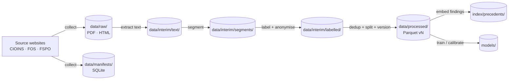

# ClaimSense — Data Flow

> How a decision moves from a source website to the precedent index: **raw → interim → processed → index**. For each stage: what goes in, what comes out, where it is stored, which module owns it, and the gate it must pass before the next stage runs.

**Author:** Diya Shrivastava · **Owning PR:** 5 (stages 2–3), with stages delivered across PRs 3–13 · **Status:** Planned

**Related:** `architecture.md` (components), `leakage-contract.md` (what may reach the model), `data-schema.md` (field-level schemas), `../04-data-sources.md` (sources, labels, anonymisation).

---

## 1. Overview

| Zone | Directory | Published? | Holds personal data? |
|---|---|---|---|
| Raw | `data/raw/<source>/` | **Never** (git-ignored) | Yes |
| Manifests | `data/manifests/` | No (contains original URLs) | No |
| Interim | `data/interim/` | **Never** (git-ignored) | Yes until stage 4 |
| Processed | `data/processed/` | Only if PR 2 redistribution box is ticked for every source | **No** |
| Index | `index/precedents/` | Same rule as processed | **No** |

**Rule:** personal data exists only in `raw/` and in `interim/` before stage 4. Nothing downstream of the anonymiser may read from `raw/`.

---

## 2. Stage-by-stage I/O

### Stage 1 — Collect `[PR 3, PR 4]`

| | |
|---|---|
| **Module** | `collect/cioins.py`, `collect/fos.py`, `collect/fspo.py` |
| **Input** | Source listing pages and document URLs |
| **Output** | `data/raw/<source>/<doc_id>.{pdf,html}` + one row per document in `data/manifests/manifest.sqlite` |
| **Rules** | ≤ 1 request per 2–3 s, single worker, identified User-Agent; resumable from the manifest; SHA-256 per file |
| **Gate** | Re-run downloads 0 files; all manifest rows validate against the shared schema (FR-01–03, NFR-08) |
| **Drops** | Non-health products (FOS keyword filter, FSPO product filter); duplicate hashes — logged, not stored twice |

### Stage 2 — Extract text `[PR 5]`

| | |
|---|---|
| **Module** | `parse/pdf_text.py` |
| **Input** | `data/raw/<source>/<doc_id>.*` |
| **Output** | `data/interim/text/<doc_id>.txt` + `data/interim/text/_extract_log.csv` (`doc_id`, `method` = `text_layer` / `ocr` / `html`, `chars`, `status`) |
| **Rules** | pdfplumber first; Tesseract only when the text layer is empty or below a minimum character count; HTML stripped with BeautifulSoup |
| **Gate** | Every failure logged with a reason and counted (FR-04) |

### Stage 3 — Segment `[PR 5]`

| | |
|---|---|
| **Module** | `parse/segment.py` |
| **Input** | `data/interim/text/<doc_id>.txt` |
| **Output** | `data/interim/segments/<doc_id>.json` with keys `complaint`, `insurer_position`, `findings`, `award`, plus `marker_rule` (which per-source / per-office rule matched) |
| **Rules** | Per-source and per-office marker rules (`../04-data-sources.md` §4); no guessing — unmatched boundaries drop the document |
| **Gate** | ≥ 95% correct boundaries on 50 hand-checked documents; every retained doc has non-empty facts and award (FR-05) |
| **Drops** | Unsegmentable documents, logged in `_segment_log.csv` with reason |

### Stage 4 — Label and anonymise `[PR 6]`

| | |
|---|---|
| **Module** | `label/outcomes.py`, then `label/anonymise.py` |
| **Input** | `data/interim/segments/<doc_id>.json` + manifest `outcome_raw` |
| **Output** | `data/interim/labelled/<doc_id>.json`: anonymised `facts_text` (complaint + insurer position), anonymised `findings_text`, `label`, `label_binary`, `rejection_reason`, `insurer_type`, `claim_amount_band` |
| **Rules** | Label from award section / source metadata only (mapping table in `../04-data-sources.md` §4); excluded outcomes dropped; anonymiser runs **before** any write to this folder |
| **Gate** | Leak probes pass; 0 PII hits on a 100-doc sample; label audit ≥ 95% (FR-06, FR-07, NFR-01, NFR-02) |
| **Drops** | Non-entertainable, withdrawn, settled; unmapped outcome wording (logged for hand resolution) |

The award text is consumed here and **not carried forward**: only the label survives.

### Stage 5 — Dedup, split, version `[PR 7]`

| | |
|---|---|
| **Module** | `dataset/dedup.py`, `dataset/split.py`, `dataset/datacard.py` |
| **Input** | All files in `data/interim/labelled/` + manifest `decision_date` |
| **Output** | `data/processed/v<hash>/{train,val,test}.parquet`, `data/processed/v<hash>/DATA_CARD.md`, `data/processed/LATEST` (pointer to current version) |
| **Rules** | MinHash near-duplicate removal **before** splitting; split by `decision_date`: train ≤ 2023, val 2024, test ≥ 2025; `dataset_version` = content hash of the sorted records |
| **Gate** | No cross-split pair above the similarity threshold; rebuild yields the same hash (FR-08, FR-09, NFR-05) |

### Stage 6 — Build precedent index `[PR 13]`

| | |
|---|---|
| **Module** | `retrieve/index.py` |
| **Input** | `data/processed/v<hash>/*.parquet` (all splits) |
| **Output** | `index/precedents/` vector store; one entry per record with metadata `doc_id`, `source`, `country`, `decision_date`, `label`, `rejection_reason`, `insurer_type` |
| **Rules** | Embeds `facts_text` for similarity; stores `findings_text` as the payload the explainer may read; every query filters on `decision_date < query_date` |
| **Gate** | Index count equals processed count; every entry carries all metadata fields (FR-13) |

### Stage 7 — Train and calibrate `[PR 9–12]`

| | |
|---|---|
| **Module** | `models/baselines.py`, `models/finetune.py`, `models/calibrate.py` |
| **Input** | `train.parquet` (`facts_text`, `label`) for fitting; `val.parquet` for model selection and calibration; `test.parquet` only in the evaluation report |
| **Output** | `models/baselines/`, `models/lora-adapter/`, `models/calibrator.pkl`; run logs in MLflow / W&B |
| **Gate** | Beats every baseline on val; test ECE ≤ 0.05 (FR-10–12, NFR-03) |

---

## 3. Record counts to log at each stage

Every stage appends one row to `reports/funnel.csv` so the data card can show where documents were lost.

| Stage | Count logged | Expected drop reasons |
|---|---|---|
| Collect | documents per source | non-health product, duplicate hash |
| Extract | text extracted / OCR used / failed | corrupt PDF, OCR empty |
| Segment | segmented / dropped | no facts marker, no award marker |
| Label | labelled / excluded / unmapped | non-entertainable, withdrawn, settled, unknown wording |
| Dedup | kept / removed as near-duplicate | republished award, same case in two listings |
| Split | train / val / test, per source and class | — |

**Risk checkpoint:** if the CIOINS count after the Label stage is below ~800, the contingency in `../scope.md` §5 applies (India becomes the out-of-distribution test set).

---

## 4. Online flow (per query) `[PR 16]`

| Step | Input | Output | Reads from |
|---|---|---|---|
| Validate input | user text | cleaned `facts`, `query_date` (today) | — |
| Topic check | `facts` | in-scope flag | topic classifier / keywords in `config.yaml` |
| Predict | `facts` | label, calibrated probability | `models/lora-adapter/`, `models/calibrator.pkl` |
| Retrieve | `facts`, `query_date` | top-k precedents dated before `query_date` | `index/precedents/` |
| Explain | prediction + precedents' `findings_text` | draft sentences with citations | LLM API (Groq / Gemini) |
| Citation check | draft sentences | supported sentences only | NLI cross-encoder |
| Gate | all of the above | `PredictionResult` or abstain | thresholds in `config.yaml` |

The user's facts are **not written to disk** in v1. Output contract: `pipeline-interface.md`.
