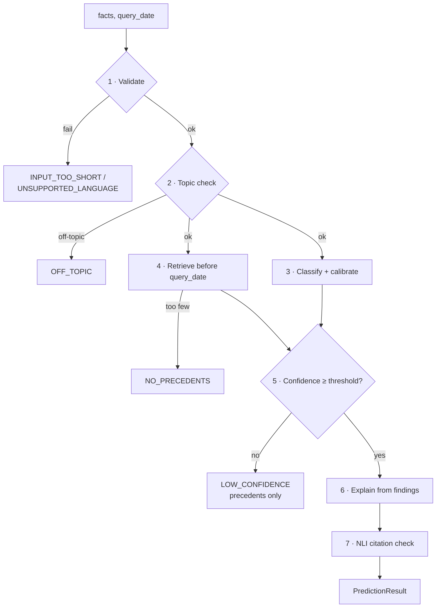

# ClaimSense — Pipeline Interface

> The public contract of `claimsense.pipeline.predict()`: its signature, input rules, output schema, abstain codes, errors and configuration. The Streamlit app, the evaluation report and the tests all call this one function, so anything they rely on is defined here.

**Author:** Diya Shrivastava · **Owning PR:** 16 (retrieval and explanation parts from PR 13) · **Status:** Planned

**Related:** `../PRD.md` §5.2 (output contract summary), FR-14–FR-17, NFR-06, NFR-07, `leakage-contract.md` (L5), `data-schema.md` §5.

---

## 1. Signature

```python
from datetime import date
from claimsense.pipeline import predict, PredictionResult

def predict(
    facts: str,
    *,
    query_date: date | None = None,   # None → today (live use)
    k: int | None = None,             # None → config.yaml retrieve.k
    explain: bool = True,             # False skips the LLM call (evaluation, latency tests)
    exclude_doc_id: str | None = None # offline evaluation: never retrieve the query document itself
) -> PredictionResult: ...
```

- **Pure function from the caller's view:** no global state changes, nothing written to disk, user facts not logged (v1).
- Models, calibrator and index are loaded once by `claimsense.pipeline.load()` on first call and cached; first-call load time is excluded from the 10 s latency budget (NFR-06).
- Runs with no GPU visible (NFR-07b).

### Input rules

| Rule | Value (from `config.yaml`) | On failure |
|---|---|---|
| Type | `str` | `TypeError` |
| Minimum length after whitespace strip | `input.min_chars` (e.g. 80) | Abstain `INPUT_TOO_SHORT` |
| Maximum length | `input.max_chars` (e.g. 6,000); longer text is truncated to the model's token limit | Truncation noted in `warnings` |
| Language | English (heuristic check) | Abstain `UNSUPPORTED_LANGUAGE` |
| `query_date` | Not in the future | `ValueError` |
| `k` | 1 ≤ k ≤ `retrieve.max_k` | `ValueError` |

The facts should cover **what happened, what the policy says, and why the insurer rejected the claim**, matching the `facts_text` the model was trained on (complaint + insurer position, `leakage-contract.md` §2).

---

## 2. Output schema

```python
from dataclasses import dataclass, field
from datetime import date
from typing import Literal

Label = Literal["upheld", "partially_upheld", "rejected"]

@dataclass(frozen=True)
class Precedent:
    doc_id: str                 # anonymised ID, safe to show
    source: Literal["cioins", "fos", "fspo"]
    country: Literal["IN", "GB", "IE"]
    decision_date: date         # always < query_date
    label: Label
    rejection_reason: str
    insurer_type: str
    similarity: float           # cosine, 0–1
    findings_excerpt: str       # anonymised, trimmed for display

@dataclass(frozen=True)
class ExplanationSentence:
    text: str
    cites: tuple[str, ...]      # doc_ids, each present in precedents
    support_score: float        # NLI entailment probability for the cited precedent(s)

@dataclass(frozen=True)
class PredictionResult:
    abstain: bool
    abstain_code: str | None            # see §3; None when abstain is False
    label: Label | None                 # None when abstain is True
    probability: float | None           # calibrated, in [0, 1]; None when abstain is True
    class_probabilities: dict[Label, float] | None  # all three, sum to 1
    precedents: list[Precedent]         # may be shown even on LOW_CONFIDENCE abstain
    explanation: list[ExplanationSentence]  # empty if none survived the citation check
    query_date: date
    warnings: list[str] = field(default_factory=list)
    model_version: str = ""             # adapter run ID
    dataset_version: str = ""           # processed dataset hash
    latency_ms: int = 0
```

### Field rules

| Field | Rule | Tested by |
|---|---|---|
| `label` / `probability` | Present iff `abstain is False`; `probability == class_probabilities[label]` | FR-14 schema test |
| `class_probabilities` | Calibrated, sum to 1 ± 1e-6 | Unit |
| `precedents` | Length k unless fewer exist before `query_date`; every `decision_date < query_date` | FR-14, FR-15 |
| `explanation` | Every sentence has ≥ 1 cite, each cite ∈ `precedents`; empty list allowed, uncited text never | FR-16 |
| `abstain_code` | One of §3; `None` iff `abstain is False` | Unit |
| `model_version`, `dataset_version` | Always filled; must match `index_meta.json` | Integration |

### What the app shows

| Result | Outcome + probability | Precedents | Explanation | Message |
|---|---|---|---|---|
| `abstain = False` | ✅ | ✅ with source country | ✅ (or "No explanation could be supported by the precedents.") | Disclaimer |
| `LOW_CONFIDENCE` | ❌ hidden (FR-17a) | ✅ labelled "Similar past cases" | ❌ | "There are not enough similar cases to estimate an outcome." + disclaimer |
| Any other code | ❌ | ❌ | ❌ | Code-specific message (§3) + disclaimer |

Probability is phrased in words in the app, e.g. "about 7 in 10 similar cases" (NFR-12).

---

## 3. Abstain codes

| Code | Trigger | Checked at step | User message (plain language) | Required by |
|---|---|---|---|---|
| `INPUT_TOO_SHORT` | Fewer than `input.min_chars` characters | 1 · validate | "Please describe what happened, what your policy says and why the claim was rejected." | NFR-12 |
| `UNSUPPORTED_LANGUAGE` | Input not detected as English | 1 · validate | "ClaimSense currently understands English only." | `scope.md` §2.4 |
| `OFF_TOPIC` | Topic check says not a health-insurance claim dispute (motor claim, recipe, general question) | 2 · topic | "This doesn't look like a rejected health-insurance claim, so ClaimSense can't assess it." | FR-17b |
| `NO_PRECEDENTS` | Fewer than `retrieve.min_k` decisions above `retrieve.min_similarity` before `query_date` | 4 · retrieve | "We couldn't find past decisions similar enough to compare with." | D8 |
| `LOW_CONFIDENCE` | Top calibrated class probability < `abstain.threshold` | 5 · gate | "Similar cases went different ways, so we can't give a reliable estimate." | FR-17a |

**Precedence:** codes are checked in the step order above; the first one that fires is returned.

**Not an abstain:** an explanation with no supported sentences. The prediction stands, `explanation = []`, and a warning `NO_SUPPORTED_EXPLANATION` is added (FR-16c).

The abstain rate per code is reported on the test set (FR-17c) and shown on the Model Card page (US-A6).

---

## 4. Execution order



Steps 3 and 4 run independently; the explainer (step 6) is called only when no abstain code has fired, so abstentions cost no LLM call.

---

## 5. Errors (raised, not abstained)

| Exception | When |
|---|---|
| `TypeError`, `ValueError` | Bad argument types or values (§1) |
| `ArtifactMismatchError` | Adapter, calibrator or index built from a different `dataset_version` |
| `ArtifactNotFoundError` | A required file under `models/` or `index/` is missing |
| `ExplainerUnavailableError` | LLM API fails after `explain.retries`; caught by the app, which shows the prediction without an explanation and adds warning `EXPLAINER_UNAVAILABLE` |

Abstentions describe the **case**; exceptions describe a **broken system**. The app never turns an exception into a prediction.

---

## 6. Configuration keys (`config.yaml`)

```yaml
input:
  min_chars: 80
  max_chars: 6000
topic:
  method: keyword_and_classifier   # fixed in PR 16
retrieve:
  k: 5
  max_k: 20
  min_k: 2
  min_similarity: 0.35
abstain:
  threshold: 0.55        # chosen from the val coverage-vs-accuracy curve; also saved in models/thresholds.json
explain:
  provider: groq          # or gemini
  max_sentences: 5
  retries: 2
cite_check:
  model: cross-encoder/nli-deberta-v3-base
  min_entailment: 0.7
```

All numbers above are starting values; PR 13 and PR 16 replace them with tuned ones and record the evidence in the PR description.

---

## 7. Example

```python
>>> r = predict(
...     "Admitted for 3 days with dengue. Policy started 14 months ago. "
...     "Insurer rejected the ₹85,000 claim saying I did not disclose diabetes, "
...     "but I was diagnosed only after the policy began."
... )
>>> r.abstain, r.label, round(r.probability, 2)
(False, 'upheld', 0.68)
>>> [(p.country, p.decision_date.year, p.label) for p in r.precedents[:3]]
[('IN', 2024, 'upheld'), ('IN', 2023, 'upheld'), ('IE', 2022, 'partially_upheld')]
>>> r.explanation[0].text, r.explanation[0].cites
('In similar cases the ombudsman required proof the condition was diagnosed before the policy began.', ('cioins-2024-03-…',))
```

Values are illustrative only; they are not results.

---

## 8. Tests (PR 16)

| Test | Checks |
|---|---|
| `test_predict_schema.py` | Field types and the field rules in §2 on fixture inputs (FR-14) |
| `test_abstain_codes.py` | Each code fires on its fixture; precedence order holds (FR-17) |
| `test_off_topic.py` | Motor claim, recipe, general question → `OFF_TOPIC` (FR-17b) |
| `test_no_future_precedents.py` | Every precedent dated before `query_date` (FR-15) |
| `test_cpu_only.py` | Passes with `CUDA_VISIBLE_DEVICES=""` (NFR-07b) |
| `bench_latency.py` | 20 fixture queries after warm-up, each ≤ 10 s; median and max logged (NFR-06) |

---

*ClaimSense describes how similar past cases were decided. It is not legal advice; the ombudsman decides each case on its own facts.*
