# ClaimSense — Roadmap

> Five phases, 18 PRs, about **11 weeks** at 10–12 hours per week alongside coursework. Week estimates are guides, not commitments.

**Author:** Diya Shrivastava · **Source:** `05-project-description.md` §8 · **Detail per PR:** `planning/pr-plan.md`

---

## 1. Phases at a glance

| Phase | PRs | Est. weeks | Cumulative | Exit criterion | Milestone |
|---|---|---|---|---|---|
| **1. Data** | 1–7 | 4 | W1–W4 | Frozen, anonymised, leakage-safe dataset v1 | **M1** Dataset v1 frozen |
| **2. Baselines** | 8–9 | 1 | W5 | Baseline numbers logged | **M2** Bar to beat set |
| **3. GenAI core** | 10–13 | 3 | W6–W8 | Calibrated fine-tuned model + cited explanations | **M3** Model + explanations |
| **4. Evaluation** | 14–15 | 1.5 | W9–mid W10 | Evaluation report + failure analysis | **M4** Report generated |
| **5. Product** | 16–18 | 1.5 | mid W10–W11 | App running, v1.0 tagged | **M5** v1.0 released |
| **Total** | **18** | **≈ 11** | | | |

---

## 2. Week-by-week guide

The per-week split below breaks each phase estimate into PRs. It is a planning aid only; slip in one week moves the rest, and the phase totals from §1 are the reference.

| Week | PRs | Focus | End-of-week check |
|---|---|---|---|
| W1 | 1, 2 | Scaffold, CI, terms-of-use audit | CI green; licence decision per source |
| W2 | 3 | CIOINS collector | Resumable manifest, no gaps |
| W3 | 4, 5 | FOS + FSPO collectors; parsing and segmentation | Shared manifest schema; ≥ 95% on 50-doc check |
| W4 | 6, 7 | Labels, PII scrub, leak probes; dedup and temporal split | Leak tests pass; 0 PII hits; dataset hash |
| W5 | 8, 9 | EDA; majority / rules / TF-IDF baselines | Macro-F1 and PR-AUC logged |
| W6 | 10 | Embeddings + LR; zero-shot LLM | Beats TF-IDF or gap explained |
| W7 | 11 | LoRA fine-tune on free GPU | Beats every baseline on validation |
| W8 | 12, 13 | Calibration; dated retrieval + cited explanations | Test ECE ≤ 0.05; every sentence cited |
| W9 | 14 | One-command evaluation report | Report regenerates from one command |
| W10 | 15, 16 | Error analysis and fairness; `predict()` with abstention | Failure modes with counts; abstain rate reported |
| W11 | 17, 18 | Streamlit app; docs and v1.0 tag | Fresh clone reproduces test metrics |

---

## 3. Timeline

```mermaid
gantt
    title ClaimSense v1.0 (relative weeks)
    dateFormat  X
    axisFormat  W%s
    section Data
    PR 1–2 Scaffold + audit      :d1, 0, 1
    PR 3 India collector         :d2, 1, 1
    PR 4–5 UK/IE + parse         :d3, 2, 1
    PR 6–7 Label + dataset       :d4, 3, 1
    M1 Dataset v1 frozen         :milestone, 4, 0
    section Baselines
    PR 8–9 EDA + baselines       :b1, 4, 1
    section GenAI core
    PR 10 Embeddings + zero-shot :g1, 5, 1
    PR 11 LoRA fine-tune         :g2, 6, 1
    PR 12–13 Calibrate + explain :g3, 7, 1
    M3 Model + explanations      :milestone, 8, 0
    section Evaluation
    PR 14 Report                 :e1, 8, 1
    PR 15 Errors + fairness      :e2, 9, 0.5
    section Product
    PR 16 Pipeline               :p1, 9.5, 0.5
    PR 17–18 App + release       :p2, 10, 1
    M5 v1.0 tagged               :milestone, 11, 0
```

---

## 4. Decision gates

Gates are points where the plan can change. Each is tied to a risk in `planning/risk-register.md` and a contingency in `scope.md` §5.

| Gate | When | Question | If no |
|---|---|---|---|
| G1 · Licence | After PR 2 (W1) | Do source terms allow collection and redistribution? | Keep data local; publish code, statistics and weights only (R2) |
| G2 · India volume | After PR 3, confirmed after PR 5 (W2–W3) | Do ≥ ~800 usable Indian health awards survive parsing? | Train on UK + Ireland; India becomes the out-of-distribution test set (R1) |
| G3 · Data quality | After PR 6 (W4) | Leak tests pass, 0 PII hits, label audit ≥ 95%? | Fix before PR 7; do not freeze dataset v1 (R3, R5, R6) |
| G4 · Model value | After PR 11 (W7) | Does the fine-tuned model beat every baseline on validation? | Report honestly, analyse why, ship the strongest model (R8) |
| G5 · Faithfulness | After PR 15 (W10) | Manual faithfulness audit ≥ 90%? | Tighten grounding and citation filter before PR 16 (R10) |

---

## 5. Buffer and slip rules

- The 11-week estimate has **no built-in buffer**. Exam weeks and the Data phase (highest uncertainty: R1, R4) are the likely places for slip.
- If a phase runs over by more than one week, re-estimate the remaining phases here rather than compressing evaluation or responsible-AI checks.
- Slip is never absorbed by adding scope cuts to safety checks (leak probes, PII scan, citation filter, disclaimer). Cut polish first: Data Explorer page, extra breakdowns, figure styling.
- New ideas raised during the build go to `planning/backlog-v2.md`, not into a week (R15).

---

## 6. Progress log

| Week | Planned PRs | Merged PRs | Notes |
|---|---|---|---|
| W1 | 1, 2 | — | |
| W2 | 3 | — | |
| W3 | 4, 5 | — | |
| W4 | 6, 7 | — | |
| W5 | 8, 9 | — | |
| W6 | 10 | — | |
| W7 | 11 | — | |
| W8 | 12, 13 | — | |
| W9 | 14 | — | |
| W10 | 15, 16 | — | |
| W11 | 17, 18 | — | |
