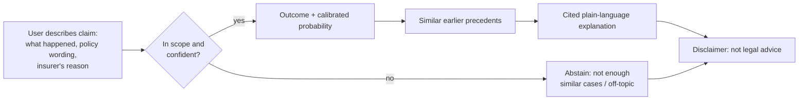

# ClaimSense — Product Requirements Document (PRD)

> What ClaimSense is, who it is for, what it must achieve, and the design decisions that constrain how it is built. Detailed requirements live in the sibling files listed in §9.

**Author:** Diya Shrivastava · **Type:** Solo GenAI project · **Status:** Planned · **Version:** 1.0 (requirements baseline)

**Sources:** `05-project-description.md` §1 and §3, with problem, users and goals from `01-project-overview.md`.

---

## 1. Summary

ClaimSense predicts how an insurance ombudsman is likely to rule on a **rejected health-insurance claim**. A user describes their dispute; the system returns:

- a **likely outcome**: *Upheld*, *Partially upheld* or *Rejected*;
- a **calibrated probability** for that outcome;
- the **most similar past decisions** as precedents;
- a **plain-language explanation** in which every sentence cites a precedent.

It learns from real, public ombudsman decisions from **India (CIOINS)**, the **UK (FOS)** and **Ireland (FSPO)**. It is a **fixed GenAI pipeline**, with no agents and no MCP, and it **abstains** when it cannot answer responsibly. It does not give legal advice.

---

## 2. Problem

Policyholders rarely understand their health-insurance policies, so when a claim is rejected they cannot tell whether the rejection is fair or worth contesting.

| Evidence | Figure | Source |
|---|---|---|
| Claims disallowed by Indian health insurers, FY24 | **₹15,100 crore**, **12.9%** of all claims filed | IRDAI Annual Report 2023-24 |
| Health-insurance complaints, FY25 | **1,37,361**, up **41%**, driven by claim disputes, delays and partial settlements | IRDAI Annual Report 2024-25 |
| Existing answers | Thousands of published ombudsman decisions on exactly these disputes, as long, scattered PDFs | CIOINS, FOS, FSPO |

**Problem statement:** the information needed to judge a rejected claim already exists in public, but in a form no ordinary policyholder can use.

---

## 3. Users

| Persona | Core question | Detail |
|---|---|---|
| **Policyholder with a rejected claim** | "Is it worth taking my case to the ombudsman?" | `user-stories.md` §2 |
| **Family member or caregiver** handling a claim | "Why was this rejected, and how did similar cases go?" | `user-stories.md` §3 |
| **Insurance advisor or consumer-help volunteer** | "Which precedents are relevant for the person I'm helping?" | `user-stories.md` §4 |

---

## 4. Goals and success metrics

### 4.1 Product goals

| Goal | Metric | Target |
|---|---|---|
| Useful prediction | Macro-F1 (3 classes) on the **temporal** test set | Beats every baseline; bootstrap CIs do not overlap the TF-IDF baseline |
| Trustworthy numbers | Expected Calibration Error (ECE) | **≤ 0.05** on test |
| No invented reasons | Share of explanation sentences backed by a cited precedent | **100%** after filter; manual audit **≥ 90%** |
| Honest failure | Abstain rate and coverage-vs-accuracy curve | Reported, operating point justified |
| Honest limits | Breakdowns by country, rejection reason, insurer type, claim size, year | Reported in the evaluation report |
| Interactive | Seconds per prediction on a laptop CPU | **≤ 10 s** (excluding first model load) |

### 4.2 Learning and career goals

- Add **LoRA/PEFT fine-tuning**, legal-text dataset construction, PII anonymisation and faithfulness checking to my skill set.
- Ship a reproducible, tested project (CI, model card, data card) that a fresh clone can rerun to the reported metrics.

### 4.3 Release criteria (v1.0)

- [ ] Frozen, anonymised, deduplicated dataset with a temporal split
- [ ] Fine-tuned model beats every baseline, with confidence intervals
- [ ] Calibration, retrieval and explanation-faithfulness results in one evaluation report
- [ ] Streamlit app with Predict, Precedent Explorer, Model Card and Data Explorer pages, a disclaimer on every page
- [ ] README, model card and data card; tagged v1.0

---

## 5. Product shape

### 5.1 User flow

### 5.2 Output contract — `predict(facts)`

| Field | Type | Meaning |
|---|---|---|
| `label` | `upheld` / `partially_upheld` / `rejected` | Most likely ombudsman outcome |
| `probability` | float in [0, 1] | Calibrated probability of `label` |
| `precedents` | list of top-k records | Similar decisions **dated before** the query |
| `explanation` | list of cited sentences | Grounded only in the precedents' findings |
| `abstain` | bool | True when confidence is low or input is off-topic |

### 5.3 App pages

| Page | Shows |
|---|---|
| **Predict** | Outcome, probability, top precedents, cited explanation, disclaimer |
| **Precedent Explorer** | Search and filter past decisions by reason, insurer type, year |
| **Model Card** | Metrics, calibration plot, known failure modes |
| **Data Explorer** | Dataset size, class balance, sources, data card |

---

## 6. Key design decisions

| # | Decision | Choice | Rationale | Alternative rejected |
|---|---|---|---|---|
| D1 | Input boundary | Facts + insurer's position only | Findings contain the answer; including them makes accuracy meaningless | Full decision text |
| D2 | Data split | Temporal (train ≤ 2023, val 2024, test 2025+) | Mirrors real use: predicting *new* disputes | Random split (overstates accuracy) |
| D3 | Labels | 3 classes + a binary "any payment" view | Partial payment is common and matters to users | Binary only |
| D4 | Model | LoRA on a small open model or encoder | Fits a free GPU; adapter weights are small | Full fine-tune; API-only zero-shot |
| D5 | Output | Calibrated probability | Users act on the number, so 70% must mean 70% | Raw softmax scores |
| D6 | Explanations | Grounded in retrieved findings, citation-checked | Prevents invented reasons | Free LLM explanation |
| D7 | Precedent retrieval | Only decisions dated before the query | Blocks leakage from the future | Unfiltered retrieval |
| D8 | Failure behaviour | Abstain when unsure or off-topic | Wrong confidence is worse than no answer | Always predict |
| D9 | Architecture | Fixed pipeline, no agents | Deterministic and measurable at every step | Agentic workflow |
| D10 | Privacy | Anonymise before writing processed text; publish derived data only | Decisions name real complainants | Publish raw text |
| D11 | Jurisdictions | India + UK + Ireland, India as primary test domain | Indian volume alone may be too small; shift becomes a finding | India only |

**Core rule (from D1):** findings are cut at the parsing stage, so only facts ever reach the model.

---

## 7. Constraints and assumptions

| Type | Item |
|---|---|
| Constraint | Solo developer, about 10–12 hours per week alongside coursework (≈ 11 weeks, 18 PRs) |
| Constraint | Free compute only: Kaggle/Colab GPU for training, CPU for inference |
| Constraint | Data use limited by each source's terms of use (PR 2 checklist) |
| Assumption | Enough usable Indian health awards survive parsing (**checkpoint after PR 3: ~800**); otherwise India becomes an out-of-distribution test set |
| Assumption | Outcome wording in Indian awards can be mapped to 3 classes by rules with ≥ 95% audited accuracy |
| Assumption | A free-tier LLM API (Groq or Gemini) is available for explanations |

---

## 8. Glossary

| Term | Meaning in ClaimSense |
|---|---|
| **Upheld** | The ombudsman sided with the complainant; insurer directed to pay in full |
| **Partially upheld** | Part payment awarded, or insurer directed to reconsider |
| **Rejected** | Complaint dismissed; the insurer's rejection stands |
| **Facts** | Complaint/background + insurer's position — the only model input |
| **Findings** | The ombudsman's reasoning — used for explanations, never as input |
| **Precedent** | A past, anonymised decision dated before the query case |
| **Calibrated** | Predicted probabilities match observed frequencies (ECE ≤ 0.05) |
| **Abstain** | The system declines to predict and says why |

---

## 9. Related documents

| File | Contents |
|---|---|
| `functional-requirements.md` | FR-01 … FR-20 |
| `non-functional-requirements.md` | NFR-01 … NFR-12 |
| `user-stories.md` | Stories for the three personas |
| `acceptance-criteria.md` | Testable check + owning PR for every FR and NFR |
| `scope.md` | In / out of scope and v2 backlog |
| `../02-architecture.md` | Components, leakage contract, repo layout |
| `../03-pr-plan.md` | 18 PRs, branches, done-when checks |
| `../04-data-sources.md` | Sources, terms checklist, labelling, anonymisation |

---

*ClaimSense describes how similar past cases were decided. It is not legal advice; the ombudsman decides each case on its own facts.*
