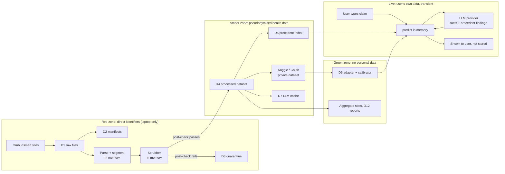

# ClaimSense — Privacy Impact Assessment

> What personal data ClaimSense touches at each stage, from raw ombudsman PDFs through to a user typing their own claim into the app. Covers who the data is about, where it lives, who can see it, the privacy risks, the controls (with the PR that delivers each one), and what risk is left over and accepted. Ombudsman decisions describe real families' medical histories and money disputes. This document exists so that nothing about that is handled by accident.

**Author:** Diya Shrivastava · **Owning PR:** 2 (assessment); controls delivered in 3, 4, 6, 7, 11, 13, 16, 17 · **Status:** Draft, assessed 2026-11-13. Re-assess before the dataset v1 freeze (PR 7) and before the v1.0 tag (PR 18)

**Related:** `../data/anonymisation-spec.md`, `../data/terms-of-use-audit.md`, `../data/manual-audit-protocol.md`, `../04-data-sources.md` §5, `../data-flow.md` §4, `../modelling/prompt-spec.md` §1 and §6, `../pipeline-interface.md`, `responsible-use.md`, `limitations.md`, FR-07, NFR-02, NFR-09, design decision D10, risks R2, R5.

---

## 1. Summary

| Stage | Personal data present? | Main risk | Residual risk after controls |
|---|---|---|---|
| Collection and raw store (PR 3–4) | **Yes, direct identifiers + health data** | Laptop loss, accidental commit, cloud sync | Low |
| Parsing and anonymisation (PR 5–6) | Yes, until the scrubber runs in memory | Scrubber misses an identifier | Low |
| Processed dataset and index (PR 7, 13) | **Pseudonymised health data** | Re-identification by combining details, or by searching the public original | Medium (accepted, see §6) |
| Training and tracking (PR 11) | Pseudonymised text on third-party cloud | Public Kaggle dataset; text logged to a tracking service | Low |
| Model weights and published stats | No | Memorisation (classifier only) | Low |
| Live app, user input (PR 16–17) | **Yes, the user's own claim** | Text sent to the LLM provider; text in logs | Medium (depends on provider terms) |

**Working position:** processed text is treated as **personal health data**, even after anonymisation. The originals stay public on the ombudsman websites with names attached, so an anonymised passage can in principle be traced back to them. Every control below follows from that position.

---

## 2. Whose data this is

| Data subject | Where they appear | What is said about them |
|---|---|---|
| **Complainants** | Every decision | Name, address, age, medical condition, treatment, claim amount, policy history, sometimes employer |
| **Family members, nominees, insured dependants** | Family-floater and group policies | Name, relationship, condition, age (including **children**) |
| **Treating doctors, hospital staff** | Facts and findings | Name, hospital, clinical opinion |
| **Ombudsman and staff** | Header and signature block | Name, office |
| **Insurer and TPA employees** | Occasionally, in correspondence quoted in facts | Name, role |
| **App users** | Live input (PR 16–17) | Their own or a relative's claim, often with health details |
| **Diya (the developer)** | User-Agent, permission emails | Name, email |

Insurers and TPAs are **companies**. Their names are kept on purpose (`anonymisation-spec.md` §3).

---

## 3. Data inventory

| ID | Data | Location | Personal data | Who can access | Leaves the laptop? | Retention |
|---|---|---|---|---|---|---|
| D1 | Raw PDFs and HTML | `data/raw/` (git-ignored) | Direct identifiers + health | Diya only | **Never** | §7 |
| D2 | Manifests | `data/manifests/` | Indirect: `url` points to the named original; `doc_id` may hold the award number | Diya only | Never | Same as D1 |
| D3 | PII quarantine | `data/interim/_pii_quarantine/` | Direct identifiers (failed post-check) | Diya only | Never | Deleted once the detector is fixed and the document re-scrubbed |
| D4 | Processed dataset | `data/processed/*.parquet` | Pseudonymised health data | Diya; FSPO portion may be published (§5) | Kaggle/Colab (private), FSPO only to public | §7 |
| D5 | Precedent index | `index/precedents/` | Embeddings + anonymised findings excerpts | Diya; local app user | Never in v1 | Rebuilt per dataset version |
| D6 | LoRA adapter, calibrator, thresholds | `models/` | None expected (trained on D4; outputs labels only) | Public with release | Yes (release) | Permanent |
| D7 | LLM cache | `data/cache/llm/` (git-ignored) | Anonymised dataset text + responses | Diya only | Sent to provider at call time | Deleted at v1.0 unless needed for reproduction |
| D8 | Audit sheets | `reports/audits/` | Anonymised snippets; **PII-audit notes risk quoting found identifiers** | Diya; committed | Yes (repo) | Permanent, once checked (§6, P-R9) |
| D9 | User input | Process memory only | User's own claim, health details | User; LLM provider | **Yes, to the LLM provider** | Not written to disk |
| D10 | Permission emails | `docs/data/permissions/` | Diya's and publisher contacts' details | Diya only | No | Kept as evidence of permission; not committed |
| D11 | Experiment tracking | MLflow (local) or W&B (cloud) | None, if §6 P-R6 is followed | Diya | W&B: yes | Delete the W&B project after v1.0 if not needed |
| D12 | Published reports | `reports/` | Aggregates; case vignettes **written in Diya's own words** | Public | Yes | Permanent |

---

## 4. Data flow and privacy zones

**Zone rules**

| Zone | Rule |
|---|---|
| Red | Never committed, synced to cloud storage, uploaded or emailed. Exists only on Diya's encrypted disk |
| Amber | May leave the laptop only to a **private** compute workspace (Kaggle/Colab) or an LLM provider. Published only for FSPO, and only as allowed by `terms-of-use-audit.md` §6 |
| Green | Publishable after the checks in §10 |
| Live | Never written to disk, cache or logs |

---

## 5. Legal and terms context

This section lists what has to be checked. It is **not** a legal opinion; the cells marked *To verify* are open questions for Diya to resolve and record before PR 7.

| Framework | Why it applies | Open question | Status |
|---|---|---|---|
| **India: Digital Personal Data Protection Act, 2023** (and its Rules) | CIOINS awards name Indian complainants and describe their health | Does personal data in awards published by the ombudsman fall outside the Act as publicly available data? Does any research exemption cover a student project? | To verify |
| **UK GDPR and Data Protection Act 2018** | FOS decisions concern UK residents; health data is special-category data | Pseudonymised text is still personal data under UK GDPR. What is the lawful basis and special-category condition for research use by an individual? | To verify (only matters if FOS permission is granted) |
| **EU GDPR (Ireland)** | FSPO decisions; health data is special-category data | Same question as for the UK. FSPO's re-use permission covers copyright, not data protection | To verify |
| **Publisher terms** | Copyright and reuse | Answered in `terms-of-use-audit.md` | Done for terms; robots.txt pending |
| **LLM provider terms** | User input and dataset text are sent to Groq or Gemini | Does the provider retain API inputs or train on them? On the free tier specifically? | Record at PR 10 (`prompt-spec.md` §3) |

**Practical stance until verified:** minimise, anonymise before writing, keep red-zone data on one machine, publish no CIOINS or FOS text, and treat a takedown request as binding (§8). These choices are safe under any reading of the frameworks above.

---

## 6. Risks and controls

Likelihood (L) and impact (I): Low / Medium / High. Impact is judged for the **person in the decision**, not for the project.

| ID | Risk | L | I | Controls | PR | Residual |
|---|---|---|---|---|---|---|
| **P-R1** | Scrubber misses a name, address, phone or reference number, and processed text exposes a family's medical history | M | H | Entities E1–E16; header name list replaced everywhere; Presidio threshold 0.4 (over-remove); regex post-check sends any hit to quarantine; **0 hits** on a 100-document manual sample, with a fresh sample after any fix | 6 | L |
| **P-R2** | **Re-identification by combination**: rare condition + insurer + state + month/year + amount points to one person | M | H | Towns and localities removed (E5); dates cut to month/year; exact ages turned into bands; employer removed for group policies (E15); manual audit explicitly checks rare-condition combinations | 6 | M |
| **P-R3** | **Reverse lookup**: a phrase from a precedent excerpt is searched on the ombudsman site and leads to the named original | M | M | Excerpts trimmed for display; `url` never shown; displayed `doc_id` must not contain the source award or reference number (check in PR 13; use a hashed display ID if it does); no CIOINS/FOS text published | 13, 17 | M (accepted: the original is already public by the ombudsman's choice; ClaimSense adds little to it) |
| **P-R4** | **Aggregation**: an index makes health disputes easier to find by condition than the scattered PDFs did | L | M | v1 runs locally only, no hosted deployment (`scope.md` §3.2); Precedent Explorer filters by reason, insurer type and year, not free-text search over people | 13, 17 | L |
| **P-R5** | Raw files leak: laptop lost, folder synced to OneDrive/Google Drive, or PDFs committed by mistake | M | H | `data/` git-ignored; pre-commit hook blocks `*.pdf` and any path under `data/raw/` or `_pii_quarantine/`; full-disk encryption on (BitLocker/FileVault); project folder excluded from cloud sync; no raw files on Kaggle/Colab | 1, 3 | L |
| **P-R6** | Third-party cloud during training: a Kaggle dataset left public, or text samples logged to W&B | M | M | Kaggle dataset set to **Private**; processed (amber) data only; tracking logs metrics, config and hashes, **never text tables or sample predictions with text**; delete the Kaggle dataset after v1.0 | 11 | L |
| **P-R7** | **User input sent to the LLM provider** for the explanation step | H | M | Notice next to the input box (§9); input box tells users to leave out names, policy numbers and phone numbers; provider and its retention terms recorded at PR 10, choosing a setting that does not train on API inputs where one exists; no caching of live calls; **proposed:** run the PR 6 scrubber on user text before the LLM call (needs a scope decision in `scope.md` §6, since it is not in the PR plan) | 10, 16, 17 | M |
| **P-R8** | User text ends up in logs, tracebacks or Streamlit telemetry | M | M | No log line contains `facts`; a logging filter redacts the field; Streamlit `browser.gatherUsageStats = false` in `.streamlit/config.toml`; exceptions shown to users are generic | 16, 17 | L |
| **P-R9** | The PII audit sheet itself quotes the identifiers it found | M | M | Audit sheet records **entity type, document ID and character offset**, never the value; checked before commit | 6 | L |
| **P-R10** | Model memorises text from training data | L | L | Trained only on scrubbed text; classifier outputs a label, not text; only adapter weights published | 11 | L |
| **P-R11** | Explanation repeats an identifier | L | M | Explainer sees only scrubbed findings and the user's own text; output shown only to that user, never stored | 13 | L |
| **P-R12** | Children's data (claims for dependants on family-floater policies) | M | M | All controls above apply; ages under 18 become `[AGE_MINOR]`; no slice or vignette is built around minors | 6, 15 | L |
| **P-R13** | Data kept longer than needed | M | L | Retention schedule (§7) | 18 | L |
| **P-R14** | A person named in a decision, or a publisher, asks for removal and there is no way to act on it | L | M | Takedown procedure (§8); `doc_id` links processed rows back to raw files locally | 7 | L |

### Controls by PR

| PR | Privacy controls delivered |
|---|---|
| 1 | `.gitignore` for `data/`, pre-commit hook blocking raw files |
| 2 | This assessment; terms audit; §5 questions recorded |
| 3, 4 | Raw files local only; User-Agent with contact; no raw upload anywhere |
| 6 | Scrubber, post-check, quarantine, manual 0-hit gate, audit-sheet rule (P-R9) |
| 7 | Data card states the anonymisation method and residual re-identification risk; takedown mapping kept |
| 10 | LLM provider retention terms recorded |
| 11 | Private Kaggle dataset; no text in tracking |
| 13 | Display ID check (P-R3); explainer input limited to scrubbed findings |
| 16 | No disk writes or caching of user input; log redaction |
| 17 | Input-box privacy notice; Streamlit telemetry off; local-only app |
| 18 | Retention actions done; this document re-assessed and signed off |

---

## 7. Retention

| Data | Keep until | Then |
|---|---|---|
| D1 raw, D2 manifests | v1.0 is tagged and the fresh-clone reproduction passes, or the permission period ends, whichever is sooner | Delete, unless a v2 rebuild is planned within 6 months and permission allows; record the decision here |
| D3 quarantine | Detector fixed and document re-scrubbed | Delete immediately |
| D4 processed | Kept with each dataset version (needed for reproduction, NFR-05) | Locally only, apart from the published FSPO portion |
| D5 index | Current dataset version | Rebuilt with each new version; old index deleted |
| D7 LLM cache | v1.0 | Delete, or keep only if reproduction needs it |
| D9 user input | End of the request | Never stored |
| D10 permission emails | As long as any data under that permission is held | Then delete |
| Kaggle dataset, W&B project | v1.0 | Delete |

---

## 8. Takedown procedure

When a complainant, someone acting for them, or a publisher asks for a decision to be removed:

1. Acknowledge within 7 days. Do not ask for more personal information than needed to find the document.
2. Find the `doc_id`(s) through the local manifest.
3. Remove the record from D1, D4, D5, D7 and any audit sheet.
4. Build a **new dataset version** (the temporal split rules are unchanged); retrain only if the record was in train and the request asks for it.
5. If the record was in a published FSPO release, publish a corrected version and withdraw the old one.
6. Log the request with date and action taken, **without** the requester's details, in `docs/data/takedowns.md`.

A publisher withdrawing permission removes **all** of that source's data in the same way.

---

## 9. User-facing privacy text

**Next to the Predict input box (PR 17):**

> Describe what happened, what your policy says and why the claim was rejected. Please **leave out names, addresses, phone numbers and policy or claim numbers**; ClaimSense doesn't need them. What you type is not saved by ClaimSense. To write the explanation, your description is sent to an external AI service (⟨provider⟩) together with the matching past decisions.

**On the Data Explorer page:**

> The past decisions shown here were published by the ombudsmen. ClaimSense has removed names, addresses, contact details, reference numbers and exact dates, but the cases still describe real people's medical and financial situations. Please use them only to understand how similar disputes were decided.

---

## 10. Sign-off checklist

Before PR 7 (dataset freeze):

- [ ] §5 open questions answered or recorded as unresolved with the stance taken
- [ ] PR 6 manual audit: 0 hits, audit sheet holds no identifier values
- [ ] Rare-combination check recorded in the audit
- [ ] `data/raw/` absent from git history (`git log --all -- data/raw` returns nothing)
- [ ] Disk encryption on; project folder excluded from cloud sync

Before v1.0 (PR 18):

- [ ] LLM provider retention terms recorded and the §9 notice names the provider
- [ ] Kaggle dataset private, or deleted
- [ ] No text in tracking runs
- [ ] Display `doc_id` checked (P-R3)
- [ ] Published files contain no CIOINS or FOS text unless permission allows it
- [ ] §7 retention actions done and dated

### Re-assessment triggers

Re-run this assessment when any of these happens: a new source is added (V2-06); user document upload is proposed (V2-07); the app is hosted (V2-08); user feedback is collected (V2-10); the LLM provider or model changes; a publisher's terms change.

---

## 11. Tests

| Test | Checks | PR |
|---|---|---|
| `test_precommit_blocks_raw` | A staged file under `data/raw/` or a `*.pdf` fails the hook | 1 |
| `test_pii_scan.py` | Post-check finds 0 hits on processed fixtures | 6 |
| `test_audit_sheet_no_values` | PII audit CSV has no column holding matched text | 6 |
| `test_display_id_opaque` | Displayed precedent IDs do not contain source award or reference numbers | 13 |
| `test_no_input_persisted` | After `predict()`, nothing new exists under `data/`, `cache/` or the log directory containing the input string | 16 |
| `test_logs_redact_facts` | A forced exception during `predict()` produces no log line containing the input | 16 |
| `test_streamlit_telemetry_off` | `.streamlit/config.toml` sets `gatherUsageStats = false` | 17 |
| `test_privacy_notice_present` | The Predict page renders the §9 notice next to the input | 17 |

---

*This assessment records the project's own reading of its privacy risks for planning purposes. It is not legal advice.*
